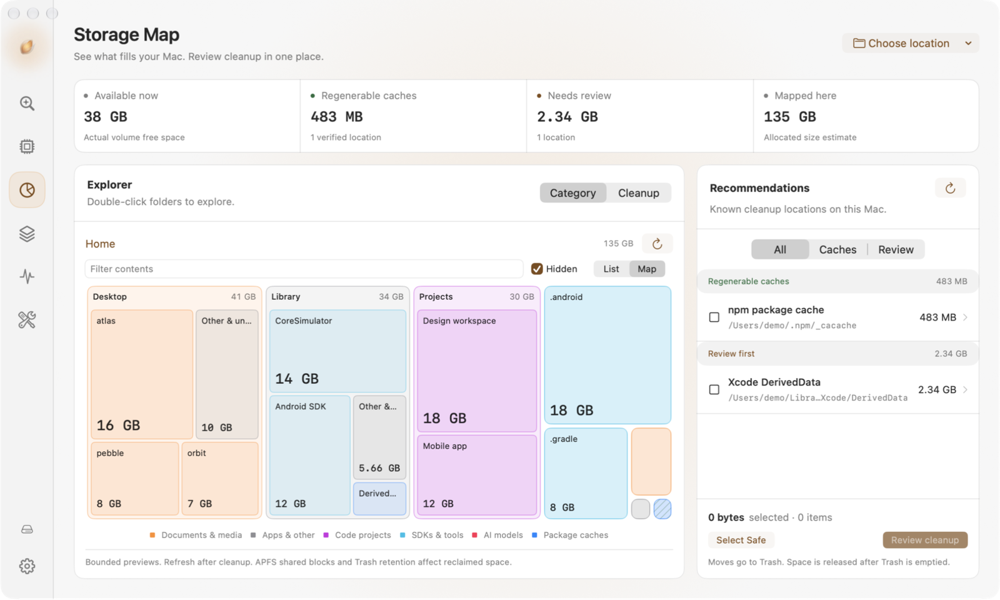

# Husk

See what fills your Mac, inspect cleanup candidates, and review exact paths before moving selected items to Trash.

Husk is an experimental native macOS app built with Swift and SwiftUI. It includes a storage map, app removal, AI storage inspection, and system monitoring. Scans run locally. There is no telemetry, privileged helper, or network client.

The [Husk Source-Available License](LICENSE) permits reading, private builds, private modifications, and private use. It does not grant general redistribution rights. See [licensing](#licensing) for the prior MIT grant and third-party exceptions.



Real app UI with example data. [Dark appearance](docs/screenshots/storage-map-dark.png).

Requires macOS 14 or later and Xcode 26.2 or later with Swift 6.2. Only the current development machine has been verified. This is not a signed public release or a completed security certification.

## Current capabilities

- Cleanup table with search, risk filters, an inspector, and explicit path review.
- Shared, serialized removal plans with expiry, file identity checks, exclusions, known running-app checks, and per-item outcomes.
- Storage overview with actual free capacity, a nested category/cleanup treemap, shared cleanup recommendations, folder navigation, list view, and complete/partial/unavailable allocated-size estimates.
- Nested app discovery and exact bundle-ID data associations. Shared group containers and fuzzy name matches are excluded; personal data requires acknowledgement.
- CPU, estimated memory, pressure/swap when available, actual volume free capacity, and process CPU/RSS. Quit requests revalidate process identity and user ownership.
- Quick Look troubleshooting, system/light/dark appearance, persistent exclusions, and optional local operation history.
- Apple-style TourKit welcome slideshow with Husk artwork, back/skip controls, keyboard navigation and Reduce Motion. Optional disk-access setup follows the tour; replay it from Settings. [Verification](docs/VERIFICATION.md).

Project cache discovery is opt-in and inspection-only. Bulk project/dependency removal, whole AI histories/models/VMs, automatic deletion, emptying Trash, MCP, Rust, SQLite, billing, and menu-bar monitoring are not implemented.

## Build and test

From the repository root:

```sh
cd Husk
swift test
xcodebuild -project Husk.xcodeproj -scheme Husk -configuration Debug \
  -derivedDataPath /tmp/husk-build CODE_SIGNING_ALLOWED=NO build
open /tmp/husk-build/Build/Products/Debug/Husk.app
```

Unsigned local builds may need macOS privacy permissions. Full Disk Access is optional for limited scans. The app deliberately excludes credentials and cloud locations even when broad read access is available. No administrator password is needed.

Husk keeps its original compact rail, warm amber actions and rounded panels, with system, light and dark appearance. AI Storage inventories recognized caches, sessions, working copies, models and installed tools. Only verified cache leaves can be selected for reviewed cleanup. Sessions, model weights, worktrees and version stores remain inspection-only. See [AI storage policy and sources](docs/AI_STORAGE.md) and the [roadmap](docs/ROADMAP.md).

Storage Map starts in map view and can browse Home, a chosen folder, or a startup disk overview. The overview measures Home, Applications, Library and `/opt` through their normal paths, with a separate System & unmeasured tile for remaining allocation. Protected paths, other users, mounted filesystems, and scan limits remain visible as incomplete coverage. Folder previews are bounded; open a folder for a fresh measurement. Recommendations use Cleanup's existing catalog, selections and reviewed Trash flow. Colors describe storage categories, while cleanup colors come from catalog policy. No new cleanup rules or shell-based deletion are introduced.

Tests use disposable fixtures and inject the move operation; they never send existing user data to Trash. Build Release with the same command and `-configuration Release`. Run `scripts/verify.sh` for the full local verification sequence, including a universal Release build. Run `scripts/profile-sizing.sh` for an opt-in 100K-entry service memory check using disposable fixtures; its default RSS budget is 160 MiB. This profiles the sizing service, not the full GUI. After a Debug build, run `scripts/ui-smoke.sh` to capture fixture screens in light/dark mode at 960×640 and 1200×720. The local runner requires Screen Recording access, verifies visible control labels, tests scan-to-results table heights with no selection, clicks Select Safe and walks the tour with mouse/keyboard input. It never runs cleanup. Set `HUSK_UI_ASSETS` if Assets.car is outside the default `/tmp/husk-ui-build` location.

## Safety limits

Sizes estimate allocated bytes, not guaranteed freed space. APFS clones, snapshots, hardlinks, and purgeable storage complicate accounting. Moving to Trash usually does not release space until Trash is emptied. Child estimates can share blocks and need not sum to the parent aggregate with shared hardlinks counted once.

Identity checks detect item replacement and root metadata changes, not every edit inside a selected folder. Foundation's path-based Trash API retains a small race between validation and moving. No path policy can prove arbitrary user data is disposable. Read the exact paths and risks before confirming. Restore using Finder's Put Back when available; Husk records destinations but does not automate restoration.

See [audit resolution](docs/AUDIT_RESOLUTION.md), [security policy](SECURITY.md), [privacy](docs/PRIVACY.md), and [contributing](CONTRIBUTING.md).

## Licensing

Husk's original code, tests, scripts, documentation, and artwork use the [Husk Source-Available License 1.0](LICENSE). You may read the source, build it, modify it privately, and use it for personal or internal business purposes. You may not redistribute the source, app binaries, or modified versions under this license, except for the limited contribution permission in its terms. Separate written permission is required for other distribution. This is source-available software, not OSI open source.

The license change does not revoke rights already granted under MIT, including rights to earlier versions and code obtained under that grant. TourKit remains MIT licensed. Apple materials keep their own terms. If the repository is made public on GitHub, GitHub's terms also permit viewing and forking on its service. See [notices](NOTICE.md) and the [licensing guide](docs/LICENSING.md).

Development continues on `main`; there is no paid feature gate. Repository publication and a signed release remain separate maintainer actions.

Read [contributing](CONTRIBUTING.md), the [code of conduct](CODE_OF_CONDUCT.md), and [support](SUPPORT.md) before opening an issue or pull request. Send security and conduct reports privately to [muzamil@mzml.dev](mailto:muzamil@mzml.dev). [Verification](docs/VERIFICATION.md) records checks and remaining distribution gates.

Mole informed independent research; no Mole code or assets were imported. Reviewed source links are recorded in [AI storage](docs/AI_STORAGE.md).

See the [documentation index](docs/README.md) for architecture, policy, verification, and release guides.
